I build automation systems end to end: market and exchange data comes in, AI agents do the heavy lifting with a human approval step in the middle, and the results go out to Sheets, Discord, X and the web.
The map below is how my stack actually runs, wired the way my real workflows are — where two tools do the same job they share a box, like Make / n8n.

Most of the code is in private repositories. Live: [orcainvestment.co.il](https://orcainvestment.co.il) · [technical write-up](https://dossierquant.netlify.app/) · dawitlior777@gmail.com
