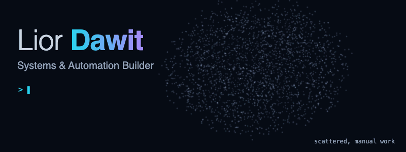
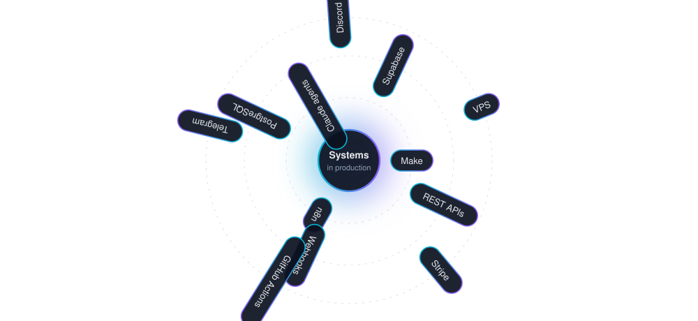
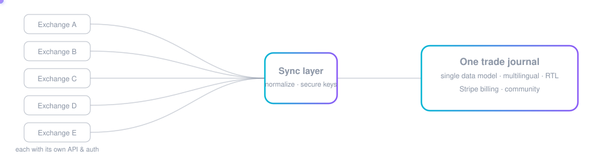
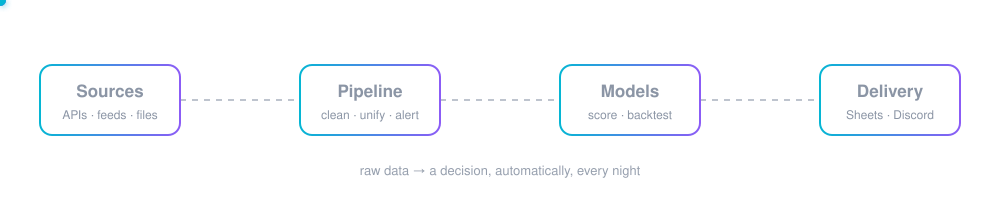

I build automation systems that replace manual, error-prone work with reliable production workflows — API integrations, automated data pipelines, and AI agents embedded in real business processes.

My favorite part is the one before the building: getting to the real problem. A client rarely arrives with the right brief, so I talk it through until we both know what is actually worth building. Then I build it, and keep improving it as people use it.

Trading is where I come from — 4–5 years in the markets — so the projects closest to me sit where trading meets technology: exchange integrations, quantitative models, tools that turn market data into decisions.

## Selected work

Most of my work lives in private repositories (client and commercial projects), so this page shows what each one does and how it is built.

### Scholar Gatekeeper — learning & scheduling platform · private client
An online platform for a trading educator, in active development and monitoring.

- A four-tier access model with role-based access control enforced in the database.
- An admin console with an immutable audit log, a booking system with race-condition protection, and a secure video delivery pipeline with a completion-gated course builder.
- Built through continuous discovery with the client: mapping their manual workflows, deciding what to automate, and shipping in small iterations.
- **Stack:** PostgreSQL, Supabase, Netlify, CDN.

### Orca — trading-journal platform · [orcainvestment.co.il](https://orcainvestment.co.il)
A SaaS product for active traders, live in production.

- Automatic trade sync from leading crypto exchanges, each with its own API and authentication, into a single data model.
- Subscription billing, a multilingual interface (including right-to-left), and an early-access community with its own Discord bot.
- A complete content and campaign automation around the product's brand: market-news monitoring, on-brand post generation, human approval on Telegram, scheduled publishing, with cost caps enforced in code.
- **Stack:** Supabase (PostgreSQL, Edge Functions), Stripe, REST APIs, Make, Claude API.

### Investment research & analysis platform · since 2024
An end-to-end research workflow that runs by itself every night.

- Data pipelines that pull, clean and unify market, macroeconomic and on-chain data, with alerting and fallbacks.
- Quantitative models for systematic strategies — signal design, multi-factor risk scoring, parameter optimization — validated through a backtesting engine.
- Results delivered automatically to Google Sheets and Discord.
- Public technical write-up: [the research dossier](https://dossierquant.netlify.app/).
- **Stack:** data pipelines, backtesting, Google Sheets API.

## Contact
dawitlior777@gmail.com

