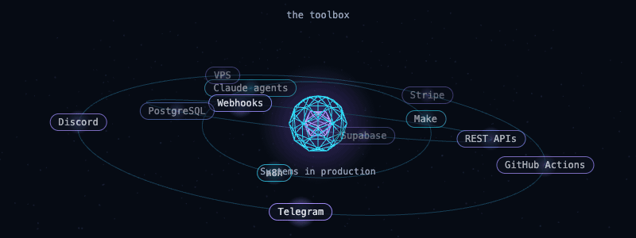
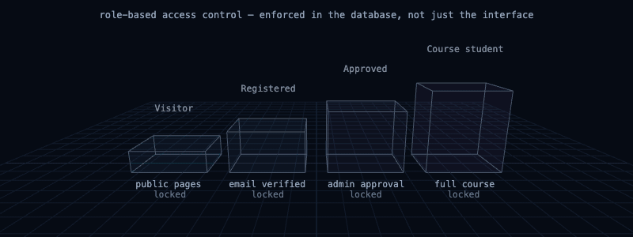
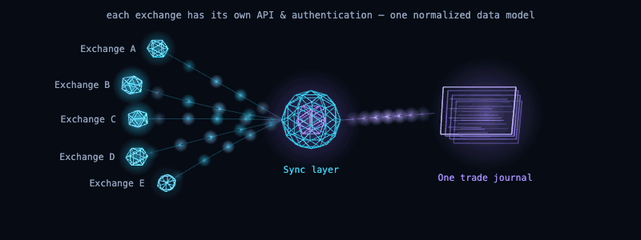
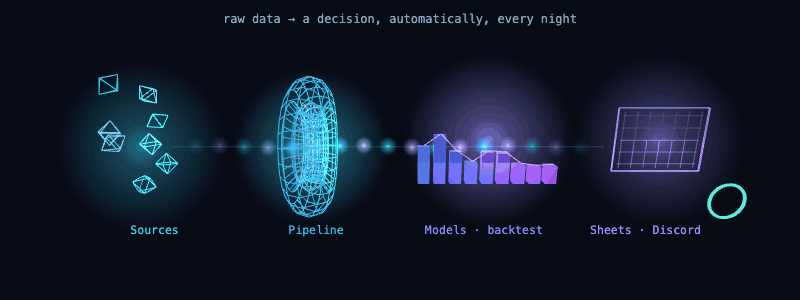

**Systems & Automation Builder** — API integrations, data pipelines and AI agents in production.
This page is about the technology I work with.

## Toolbox

| | |
|---|---|
| **Automation** | Make · n8n · REST APIs · Webhooks · HMAC / OAuth authentication |
| **AI** | Claude agents · LLM orchestration · Prompt engineering · Multi-agent workflows · Human-in-the-loop |
| **Data & backend** | PostgreSQL · Supabase (Edge Functions, RLS, scheduled jobs) · Database design |
| **Payments & integrations** | Stripe Billing · Exchange APIs · Google Workspace APIs · Discord & Telegram bots |
| **Infrastructure** | GitHub Actions (CI/CD) · Netlify · CDN · VPS hosting · Error monitoring |
| **Quantitative** | Backtesting · Risk scoring · Data pipelines |

## Where the stack runs

Most of the code is in private repositories, so these are the technologies behind each system.

### Access control in the database

**PostgreSQL** row-level security · database triggers for an immutable audit log · signed URLs · CDN · Netlify

### Exchange integrations · [orcainvestment.co.il](https://orcainvestment.co.il)

**REST APIs** · HMAC authentication · Supabase Edge Functions · Stripe · Make · Claude API · Discord & Telegram bots

### Data pipelines & backtesting

**Scheduled pipelines** · backtesting · risk scoring · Google Sheets API · Discord · [technical write-up](https://dossierquant.netlify.app/)

dawitlior777@gmail.com

