Most of the code is in private repositories. Live: [orcainvestment.co.il](https://orcainvestment.co.il) · [technical write-up](https://dossierquant.netlify.app/) · dawitlior777@gmail.com

Thanks for stopping by — enjoy your visit.

